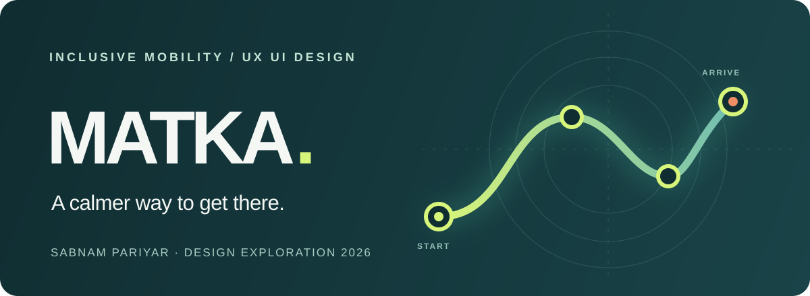

<div align="center">



<br>

### An inclusive journey-planning experience, designed around people.

**UX/UI DESIGN** · **SERVICE DESIGN** · **INTERACTIVE WEB PROTOTYPE** · **ACCESSIBILITY**

[**▶ LAUNCH INTERACTIVE DEMO**](https://sabnampariyar.github.io/MATKA-Inclusive-Public-Transport-Journey-Planner-UX-UI-Case-Study/) &nbsp;·&nbsp; [**View project files**](dist/) &nbsp;·&nbsp; [**Explore design system**](#design-system)

<sub>Public, browser-based prototype · No login or installation required.</sub>

</div>

---

## The idea

### The best journey isn't always the fastest one.

Getting from A to B should feel understandable, comfortable and accessible. Yet planning tools often prioritize schedules and route codes over the questions people actually have: *Where do I go? How many times will I transfer? Can I board without stairs? Which option will feel easiest?*

**MATKA** is an independent UX/UI concept exploring a calmer, more inclusive public transport journey planner. It presents route choices with accessible boarding information, clear comparisons and a visual map of the selected journey.

The setting is **Oulu, Finland**, with sample routes and timings created for this design exploration.

## The experience

| 01 · Plan | 02 · Compare | 03 · Understand |
| :--- | :--- | :--- |
| Select origin, destination and travel preferences. | Compare illustrative journey options and prioritize step-free travel. | Inspect the selected route on an animated conceptual map, then save a route locally in the demo. |

The interactive prototype includes:

- A responsive journey-planning interface with route switching.
- Step-free journey preference and route comparison cards.
- A stylized route map with selected-route feedback.
- A dedicated **case study** explaining the problem, design principles and proposed service journey.
- A **design system** view with color tokens, typography, controls, states and an original abstract moodboard.

## Design thinking

Three principles guide the experience:

1. **Clarity first:** communicate useful journey details before system terminology.
2. **Access by default:** make step-free boarding an ordinary planning preference, not a hidden exception.
3. **Confidence in motion:** show why a route is recommended and what happens next.

### A proposed service journey

**Discover** → **Decide** → **Travel** → **Arrive**

The portfolio case study includes a plan for task-based usability testing, accessibility walkthroughs and confidence interviews. These are **proposed validation activities**, not studies claimed to have been conducted.

## Design system

| Token | Value | Use |
| :--- | :--- | :--- |
| Deep pine | `#102D31` | Main surfaces and typography |
| Spring lime | `#D7F47B` | Primary actions |
| Warm coral | `#EF8E65` | Journey route highlight |
| Cloud | `#F4F7F4` | Background and breathable space |
| Sage slate | `#76918E` | Supporting UI |

**Typography:** Manrope + DM Sans. The style balances friendly geometric forms with clear hierarchy and restrained visual motion.

## Project files

```text
MATKA/
├── README.md
├── assets/
│   └── matka-cover.svg
├── dist/
│   ├── index.html         Interactive prototype + case study + design system
│   ├── styles.css         Responsive layout and design tokens
│   └── app.js             Client-side route selection and interactions
└── .github/workflows/
    └── deploy-pages.yml   GitHub Pages publication workflow
```

This is a **buildless static HTML/CSS/JavaScript** project. To try it locally, serve the `dist/` folder with any static web server. No API key, framework installation or backend is needed.

> **Concept disclaimer:** MATKA is a portfolio demonstration, not an official transport provider, live timetable or journey advice service. All trip details and routes are illustrative; this prototype does not use real-time transit feeds.

---

<div align="center">

**MATKA — Move with confidence.**

Independent UX/UI and service-design concept · **Sabnam Pariyar** · 2026

</div>
